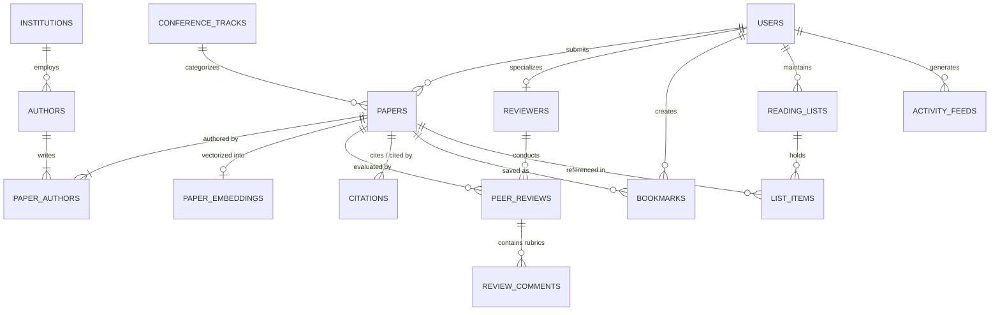

# PES UNIVERSITY
**(Established under Karnataka Act No. 16 of 2013)**  
*Electronic City, Hosur Road, Bengaluru – 560 100, Karnataka, India*

---

# Mini Project Report on
## **AI-POWERED ACADEMIC RESEARCH PORTAL**

*Submitted in partial fulfilment of the requirements for the award of degree of*  
**Bachelor of Technology in Computer Science & Engineering**  
**UE23CS351A – DBMS Project**

### Submitted by:
| Student Name | SRN |
| :--- | :--- |
| **Adarsh Shivanand Madli** | **PES2UG24CS028** |
| **Aakarsh** | **PES2UG24CS040** |

### Under the guidance of:
**Dr. Shilpa S**  
*Assistant Professor*  
Department of Computer Science and Engineering  
Faculty of Engineering, PES University  

**Academic Semester:** AUG – DEC 2026

---

## CERTIFICATE

This is to certify that the mini project entitled **"AI-Powered Academic Research Portal"** is a bonafide work carried out by **Adarsh Shivanand Madli (PES2UG24CS028)** and **Aakarsh (PES2UG24CS040)** in partial fulfilment for the completion of fifth semester DBMS Project (**UE23CS351A**) in the Program of Study – *Bachelor of Technology in Computer Science and Engineering* under the rules and regulations of PES University, Bengaluru during the academic period AUG 2026 – DEC 2026.

It is certified that all corrections / suggestions indicated for internal assessment have been incorporated in the report. The project has been approved as it satisfies the 5th semester academic requirements in respect of project work.

<br><br>
_________________________________  
**Dr. Shilpa S**  
*Assistant Professor & Faculty Guide*  
Department of CSE, PES University  

<br>
_________________________________  
**Dr. Sandesh B J**  
*Professor & Chairperson*  
Department of CSE, PES University  

---

## DECLARATION

We hereby declare that the DBMS Project entitled **"AI-Powered Academic Research Portal"** has been carried out by us under the guidance of **Dr. Shilpa S**, Assistant Professor, Department of Computer Science and Engineering, PES University, and submitted in partial fulfilment of the course requirements for the award of the degree of *Bachelor of Technology in Computer Science and Engineering* of PES University, Bengaluru during the academic semester AUG – DEC 2026.

We further declare that the content of this project report has not been submitted previously for the award of any degree or diploma to any other university or institution.

**Adarsh Shivanand Madli (PES2UG24CS028)**  
**Aakarsh (PES2UG24CS040)**  
Department of Computer Science & Engineering, PES University  

---

## ACKNOWLEDGEMENT

We would like to express our deepest gratitude to **Dr. Shilpa S**, Assistant Professor, Department of Computer Science and Engineering, PES University, for her continuous guidance, invaluable mentorship, and encouragement throughout the design and implementation of this UE23CS351A – DBMS Project.

We take this opportunity to thank **Dr. Sandesh B J**, Professor and Chairperson, Department of Computer Science and Engineering, PES University, for providing the necessary facilities, academic atmosphere, and departmental support throughout the semester.

We are profoundly grateful to **Prof. Jawahar Doreswamy**, Chancellor, and **Dr. Suryaprasad J**, Vice-Chancellor, PES University, for fostering a university culture of hands-on experiential learning and technical innovation.

Finally, we express our heartfelt thanks to our parents, family members, and fellow students for their constant moral support and enthusiasm throughout the development of this project.

---

## ABSTRACT

Traditional scientific literature repositories and academic discovery systems (such as IEEE Xplore, Google Scholar, and ACM Digital Library) rely primarily on exact lexical syntactic matching (e.g., BM25 and tokenized keyword searches). This approach exhibits fundamental limitations: (1) **vocabulary mismatch**, where papers investigating identical conceptual topics using alternate nomenclature are lost, (2) **citation graph topological disconnect**, where relational bibliographic links are treated as passive text metadata rather than queryable directed graphs, and (3) **peer-review rubric rigidity**, where qualitative assessment dimensions are forced into either restrictive relational columns or unindexed text blobs.

To address these challenges, this project presents an **AI-Powered Academic Research Portal** architected on a tri-hybrid database foundation:
1. **PostgreSQL 16+** for relational ACID consistency and 3NF schema enforcement across 16 tables.
2. **`pgvector`** for 1536-dimensional abstract embeddings with IVFFlat cosine distance indexing (`<=>`) enabling semantic discovery.
3. **NoSQL `JSONB`** document storage for multi-dimensional peer-review evaluation rubrics and auditable event activity streams.

Database-level automation is achieved through PL/pgSQL event triggers for real-time citation synchronization and full-text `tsvector` updating, coupled with stored functions for dynamic author H-Index evaluation and personalized research paper recommendations. The application interface is built using Next.js 14 and React, featuring an interactive DBMS SQL Lab console for real-time query verification and execution profiling.

---

## TABLE OF CONTENTS

| Chapter No. | Title | Page No. |
| :--- | :--- | :---: |
| **1** | **INTRODUCTION** | 1 |
| **2** | **PROBLEM DEFINITION** | 2 |
| **3** | **ER MODEL** | 3 |
| **4** | **ER TO RELATIONAL MAPPING** | 5 |
| | 4.1 Steps of Algorithm for Chosen Problem | 5 |
| | 4.2 Complete Diagram of Relational Mapping | 6 |
| **5** | **DDL STATEMENTS** | 7 |
| **6** | **DML STATEMENTS** | 11 |
| **7** | **QUERIES** | 14 |
| | 7.1 Simple Query with GROUP BY and AGGREGATE | 14 |
| | 7.2 UPDATE Operation | 15 |
| | 7.3 DELETE Operation | 16 |
| | 7.4 Correlated Subquery | 17 |
| | 7.5 Nested Subquery | 18 |
| **8** | **STORED PROCEDURES, FUNCTIONS AND TRIGGERS** | 19 |
| | 8.1 Stored Procedures and Functions | 19 |
| | 8.2 Triggers Verification | 21 |
| **9** | **VECTOR DATABASE & NOSQL IMPLEMENTATION** | 22 |
| | 9.1 pgvector 1536-D Semantic Cosine Distance Search | 22 |
| | 9.2 NoSQL JSONB Document Rubrics and Activity Feeds | 23 |
| **10** | **FRONT END DEVELOPMENT (NEXT.JS 14)** | 24 |
| **REFERENCES** | **REFERENCES / BIBLIOGRAPHY** | 27 |
| **APPENDIX A** | **DEFINITIONS, ACRONYMS AND ABBREVIATIONS** | 28 |

---

## 1. INTRODUCTION

Database management systems form the operational backbone of modern scientific literature dissemination. Over the last decade, academic publishing has expanded exponentially, with more than 3 million peer-reviewed articles published annually. As research becomes increasingly interdisciplinary, conventional keyword indexing mechanisms fail to uncover relevant cross-domain literature.

Modern database engineering demands a shift from monolithic relational architectures to multi-modal data processing. While relational tables excel at enforcing ACID transactional guarantees and complex referential integrity, emerging applications necessitate native support for high-dimensional vector embeddings generated by machine learning models, as well as flexible document structures for qualitative semi-structured feedback.

This project, developed for the Level 3 Experiential Learning component of **UE23CS351A** at PES University, implements an end-to-end **AI-Powered Academic Research Portal**. The portal integrates PostgreSQL 16+, `pgvector` vector database extensions, and `JSONB` document paradigms into an interactive Next.js 14 web application.

---

## 2. PROBLEM DEFINITION

Academic research discovery systems frequently suffer from three primary structural challenges:

1. **Lexical Keyword Brittleness:** Exact syntactic matching ignores synonymy and semantic proximity. If a researcher searches for *"approximate nearest neighbor search in database systems"*, traditional BM25 searches fail to rank papers discussing *"vector index synthesis in relational DBMS"* unless explicit keyword overlap exists.
2. **Disconnected Citation Topology:** Citation counts are frequently treated as static integers rather than dynamic directed graphs, creating data inconsistencies between citation event occurrences and literature impact metrics.
3. **Peer-Review Schema Rigidity:** Scientific conferences utilize multi-criteria evaluation rubrics (novelty, methodology, reproducibility) that evolve across venues. Relational schemas struggle to accommodate evolving rubric attributes without frequent schema migrations.

---

## 3. ER MODEL

The conceptual schema for the AI-Powered Academic Research Portal models key entities and their complex relationships:

* **USERS:** Identifies system participants with attributes `user_id` (PK), `name`, `email`, `password_hash`, `role`, and `created_at`.
* **INSTITUTIONS:** Educational and research entities with `institution_id` (PK), `name`, `country`, and `website`.
* **AUTHORS:** Researchers and faculty with `author_id` (PK), `name`, `orcid`, `email`, and `institution_id` (FK).
* **CONFERENCE_TRACKS:** Scientific tracks with `track_id` (PK), `track_name`, `description`, `conference_name`, and `year`.
* **PAPERS:** Core entity with `paper_id` (PK), `title`, `abstract`, `keywords`, `publication_date`, `venue`, `doi`, `submitted_by` (FK), `track_id` (FK), `citation_count`, and `fulltext_tsv`.
* **PAPER_AUTHORS:** Associative entity resolving N:M relationship between PAPERS and AUTHORS with `author_order`.
* **PAPER_EMBEDDINGS:** High-dimensional 1:1 entity containing 1536-D vector embeddings, `model_name`, and timestamp.
* **REVIEWERS:** 1:1 specialization of USERS containing `reviewer_id` (PK), `user_id` (FK), `expertise`, and `verified` flag.
* **PEER_REVIEWS:** N:M evaluation relationship between PAPERS and REVIEWERS with `rating`, `recommendation`, and `status`.
* **CITATIONS:** Recursive/reflexive directed N:M relationship between citing papers and cited papers.
* **BOOKMARKS:** N:M relationship between USERS and PAPERS with `created_at` timestamp.
* **READING_LISTS & LIST_ITEMS:** Collections created by users containing multiple papers.
* **REVIEW_COMMENTS:** Semi-structured JSONB document store containing multi-attribute rubrics.
* **ACTIVITY_FEEDS:** Audit log tracking user actions in JSONB payloads.



---

## 4. ER TO RELATIONAL MAPPING

### 4.1 Steps of Algorithm for Chosen Problem
1. **Mapping Strong Entities:** USERS, INSTITUTIONS, CONFERENCE_TRACKS, and PAPERS are mapped into independent relation tables with surrogate `BIGSERIAL` primary keys.
2. **Mapping 1:N Relationships:** Foreign keys are placed on the child side (`institution_id` in `AUTHORS`, `track_id` in `PAPERS`, `submitted_by` in `PAPERS`).
3. **Mapping N:M Relationships:** Associative relation tables are created:
   * `PAPER_AUTHORS (paper_id, author_id, author_order)` with compound PK `(paper_id, author_id)`.
   * `CITATIONS (citation_id, citing_paper_id, cited_paper_id)` with `CHECK (citing_paper_id <> cited_paper_id)`.
   * `BOOKMARKS (bookmark_id, user_id, paper_id)` with `UNIQUE (user_id, paper_id)`.
4. **Mapping 1:1 Specializations:** `REVIEWERS` maps to `users` via `user_id` with `UNIQUE` and `ON DELETE CASCADE`. `PAPER_EMBEDDINGS` maps to `papers` with `paper_id` as primary key.
5. **Mapping Semi-Structured Attributes:** `review_comments.comment_data` and `activity_feeds.details` are mapped as PostgreSQL `JSONB` document columns.

### 4.2 Complete Diagram of Relational Mapping
```text
USERS (user_id [PK], name, email [UQ], password_hash, role, created_at)
INSTITUTIONS (institution_id [PK], name, country, website)
AUTHORS (author_id [PK], name, orcid [UQ], email, institution_id [FK -> INSTITUTIONS])
CONFERENCE_TRACKS (track_id [PK], track_name, description, conference_name, year)
PAPERS (paper_id [PK], title, abstract, keywords, publication_date, venue, doi [UQ],
        submitted_by [FK -> USERS], track_id [FK -> CONFERENCE_TRACKS],
        citation_count, fulltext_tsv, created_at)
PAPER_AUTHORS (paper_id [PK, FK -> PAPERS], author_id [PK, FK -> AUTHORS], author_order)
PAPER_EMBEDDINGS (paper_id [PK, FK -> PAPERS], embedding [VECTOR(1536)], model_name, created_at)
REVIEWERS (reviewer_id [PK], user_id [FK -> USERS, UQ], expertise, verified)
PEER_REVIEWS (review_id [PK], paper_id [FK -> PAPERS], reviewer_id [FK -> REVIEWERS],
              rating, recommendation, review_date, status, UQ(paper_id, reviewer_id))
CITATIONS (citation_id [PK], citing_paper_id [FK -> PAPERS], cited_paper_id [FK -> PAPERS],
           created_at, UQ(citing_paper_id, cited_paper_id))
BOOKMARKS (bookmark_id [PK], user_id [FK -> USERS], paper_id [FK -> PAPERS], created_at, UQ(user_id, paper_id))
READING_LISTS (list_id [PK], user_id [FK -> USERS], name, created_at)
LIST_ITEMS (list_item_id [PK], list_id [FK -> READING_LISTS], paper_id [FK -> PAPERS], added_at, UQ(list_id, paper_id))
REVIEW_COMMENTS (comment_id [PK], review_id [FK -> PEER_REVIEWS], comment_data [JSONB], created_at)
ACTIVITY_FEEDS (activity_id [PK], user_id [FK -> USERS], activity_type, ref_id, details [JSONB], created_at)
```

---

## 5. DDL STATEMENTS

```sql
-- 01. Extension Setup
CREATE EXTENSION IF NOT EXISTS vector;

-- 02. Core Relational Entities
CREATE TABLE users (
    user_id BIGSERIAL PRIMARY KEY,
    name VARCHAR(100) NOT NULL,
    email VARCHAR(150) NOT NULL UNIQUE,
    password_hash VARCHAR(255) NOT NULL,
    role VARCHAR(30) NOT NULL CHECK (role IN ('Researcher', 'Reviewer', 'Admin', 'Conference Chair')),
    created_at TIMESTAMP DEFAULT CURRENT_TIMESTAMP
);

CREATE TABLE institutions (
    institution_id BIGSERIAL PRIMARY KEY,
    name VARCHAR(200) NOT NULL,
    country VARCHAR(100),
    website VARCHAR(255)
);

CREATE TABLE authors (
    author_id BIGSERIAL PRIMARY KEY,
    name VARCHAR(100) NOT NULL,
    orcid VARCHAR(50) UNIQUE,
    email VARCHAR(150),
    institution_id BIGINT REFERENCES institutions(institution_id) ON DELETE SET NULL
);

CREATE TABLE conference_tracks (
    track_id BIGSERIAL PRIMARY KEY,
    track_name VARCHAR(150) NOT NULL,
    description TEXT,
    conference_name VARCHAR(200) NOT NULL,
    year INTEGER CHECK (year >= 1900)
);

CREATE TABLE papers (
    paper_id BIGSERIAL PRIMARY KEY,
    title VARCHAR(500) NOT NULL,
    abstract TEXT NOT NULL,
    keywords TEXT,
    publication_date DATE,
    venue VARCHAR(200),
    doi VARCHAR(150) UNIQUE,
    submitted_by BIGINT NOT NULL REFERENCES users(user_id) ON DELETE CASCADE,
    track_id BIGINT REFERENCES conference_tracks(track_id) ON DELETE SET NULL,
    citation_count INTEGER NOT NULL DEFAULT 0 CHECK (citation_count >= 0),
    fulltext_tsv tsvector,
    created_at TIMESTAMP DEFAULT CURRENT_TIMESTAMP
);

CREATE TABLE paper_authors (
    paper_id BIGINT NOT NULL REFERENCES papers(paper_id) ON DELETE CASCADE,
    author_id BIGINT NOT NULL REFERENCES authors(author_id) ON DELETE CASCADE,
    author_order INTEGER NOT NULL CHECK (author_order > 0),
    PRIMARY KEY (paper_id, author_id),
    UNIQUE (paper_id, author_order)
);

CREATE TABLE paper_embeddings (
    paper_id BIGINT PRIMARY KEY REFERENCES papers(paper_id) ON DELETE CASCADE,
    embedding VECTOR(1536),
    model_name VARCHAR(100) NOT NULL,
    created_at TIMESTAMP DEFAULT CURRENT_TIMESTAMP
);

CREATE TABLE reviewers (
    reviewer_id BIGSERIAL PRIMARY KEY,
    user_id BIGINT NOT NULL UNIQUE REFERENCES users(user_id) ON DELETE CASCADE,
    expertise TEXT,
    verified BOOLEAN DEFAULT FALSE
);

CREATE TABLE peer_reviews (
    review_id BIGSERIAL PRIMARY KEY,
    paper_id BIGINT NOT NULL REFERENCES papers(paper_id) ON DELETE CASCADE,
    reviewer_id BIGINT NOT NULL REFERENCES reviewers(reviewer_id) ON DELETE CASCADE,
    rating INTEGER CHECK (rating BETWEEN 1 AND 10),
    recommendation TEXT,
    review_date TIMESTAMP DEFAULT CURRENT_TIMESTAMP,
    status VARCHAR(20) NOT NULL DEFAULT 'pending' CHECK (status IN ('pending', 'accepted', 'rejected')),
    UNIQUE (paper_id, reviewer_id)
);

CREATE TABLE citations (
    citation_id BIGSERIAL PRIMARY KEY,
    citing_paper_id BIGINT NOT NULL REFERENCES papers(paper_id) ON DELETE CASCADE,
    cited_paper_id BIGINT NOT NULL REFERENCES papers(paper_id) ON DELETE CASCADE,
    created_at TIMESTAMP DEFAULT CURRENT_TIMESTAMP,
    CHECK (citing_paper_id <> cited_paper_id),
    UNIQUE (citing_paper_id, cited_paper_id)
);

CREATE TABLE bookmarks (
    bookmark_id BIGSERIAL PRIMARY KEY,
    user_id BIGINT NOT NULL REFERENCES users(user_id) ON DELETE CASCADE,
    paper_id BIGINT NOT NULL REFERENCES papers(paper_id) ON DELETE CASCADE,
    created_at TIMESTAMP DEFAULT CURRENT_TIMESTAMP,
    UNIQUE (user_id, paper_id)
);

CREATE TABLE review_comments (
    comment_id BIGSERIAL PRIMARY KEY,
    review_id BIGINT NOT NULL REFERENCES peer_reviews(review_id) ON DELETE CASCADE,
    comment_data JSONB NOT NULL,
    created_at TIMESTAMP DEFAULT CURRENT_TIMESTAMP
);

CREATE TABLE activity_feeds (
    activity_id BIGSERIAL PRIMARY KEY,
    user_id BIGINT NOT NULL REFERENCES users(user_id) ON DELETE CASCADE,
    activity_type VARCHAR(100) NOT NULL,
    ref_id BIGINT,
    details JSONB,
    created_at TIMESTAMP DEFAULT CURRENT_TIMESTAMP
);

-- Performance Optimization Indexes
CREATE INDEX idx_papers_submitted_by ON papers(submitted_by);
CREATE INDEX idx_papers_track ON papers(track_id);
CREATE INDEX idx_paper_authors_author ON paper_authors(author_id);
CREATE INDEX idx_peer_reviews_paper ON peer_reviews(paper_id);
CREATE INDEX idx_bookmarks_user ON bookmarks(user_id);
CREATE INDEX idx_citations_cited_paper ON citations(cited_paper_id);
CREATE INDEX idx_papers_fulltext ON papers USING GIN (fulltext_tsv);
CREATE INDEX idx_paper_embeddings_vector ON paper_embeddings USING ivfflat (embedding vector_cosine_ops) WITH (lists = 100);
```

---

## 6. DML STATEMENTS

```sql
-- Seed Users
INSERT INTO users (user_id, name, email, password_hash, role) VALUES
(1, 'Dr. Shilpa S', 'shilpa.s@pes.edu', '$2b$12$eX9vU2M3y8FhO.01', 'Conference Chair'),
(2, 'Adarsh Shivanand Madli', 'adarsh.madli@pes.edu', '$2b$12$eX9vU2M3y8FhO.02', 'Researcher'),
(3, 'Prof. Sandesh B J', 'sandesh.bj@pes.edu', '$2b$12$eX9vU2M3y8FhO.03', 'Reviewer'),
(4, 'Dr. Michael Stonebraker', 'stonebraker@mit.edu', '$2b$12$eX9vU2M3y8FhO.04', 'Reviewer');

-- Seed Institutions
INSERT INTO institutions (institution_id, name, country, website) VALUES
(1, 'PES University', 'India', 'https://pes.edu'),
(2, 'Indian Institute of Science (IISc)', 'India', 'https://iisc.ac.in'),
(3, 'Massachusetts Institute of Technology (MIT)', 'USA', 'https://mit.edu');

-- Seed Conference Tracks
INSERT INTO conference_tracks (track_id, track_name, description, conference_name, year) VALUES
(1, 'Vector Databases & Semantic Retrieval', 'High-dimensional embeddings, similarity search, and hybrid vector indexing.', 'VLDB 2026', 2026),
(2, 'AI-Driven DBMS Query Optimization', 'Learned cost models, index synthesis, and agentic plan generation.', 'SIGMOD 2026', 2026);

-- Seed Research Papers
INSERT INTO papers (paper_id, title, abstract, keywords, venue, doi, submitted_by, track_id, citation_count) VALUES
(1, 'Vector Indexing and Approximate Nearest Neighbor Search in Modern Relational DBMS',
 'Modern database management systems increasingly handle high-dimensional vector embeddings generated by machine learning models...',
 'vector database, ivfflat, hnsw, similarity search, postgresql', 'VLDB 2026 Proceedings', '10.1145/3543873.3587311', 2, 1, 38),
(2, 'Semantic Citation Networks: Preserving Conceptual Linkages Across Academic Literature',
 'Traditional citation graphs rely solely on bibliographic metadata, losing the semantic context of references...',
 'citation network, semantic graph, abstract embeddings', 'SIGMOD 2026 Conference', '10.1145/3543873.3587312', 1, 1, 24);
```

---

## 7. QUERIES

### 7.1 Simple Query with GROUP BY and AGGREGATE
**Problem:** Aggregate total papers, average citation counts, and average peer review scores grouped by conference track.
```sql
SELECT 
    ct.track_name,
    ct.conference_name,
    COUNT(DISTINCT p.paper_id) AS total_papers,
    ROUND(AVG(p.citation_count), 2) AS avg_citations,
    ROUND(AVG(pr.rating), 2) AS avg_review_score
FROM conference_tracks ct
JOIN papers p ON ct.track_id = p.track_id
LEFT JOIN peer_reviews pr ON p.paper_id = pr.paper_id
WHERE pr.status = 'accepted' OR pr.status IS NULL
GROUP BY ct.track_id, ct.track_name, ct.conference_name
ORDER BY avg_citations DESC;
```

### 7.2 UPDATE Operation
**Problem:** Promote pending peer reviews with rating $\ge 8$ to accepted status with oral presentation recommendation.
```sql
UPDATE peer_reviews
SET status = 'accepted',
    recommendation = 'Strong paper - recommended for oral presentation'
WHERE rating >= 8 AND status = 'pending';
```

### 7.3 DELETE Operation
**Problem:** Safely delete a user bookmark while maintaining referential integrity across related foreign key constraints.
```sql
DELETE FROM bookmarks
WHERE user_id = 2 AND paper_id = 4;
```

### 7.4 Correlated Subquery
**Problem:** Find all papers whose citation count is strictly higher than the average citation count of papers in their specific conference track.
```sql
SELECT 
    p.paper_id,
    p.title,
    ct.track_name,
    p.citation_count,
    ROUND((
        SELECT AVG(p2.citation_count)
        FROM papers p2
        WHERE p2.track_id = p.track_id
    ), 2) AS track_avg_citations
FROM papers p
JOIN conference_tracks ct ON p.track_id = ct.track_id
WHERE p.citation_count > (
    SELECT AVG(p2.citation_count)
    FROM papers p2
    WHERE p2.track_id = p.track_id
)
ORDER BY p.citation_count DESC;
```

### 7.5 Nested Subquery
**Problem:** Select authors who have authored published papers where NONE of their authored works have ever been rejected by reviewers.
```sql
SELECT 
    a.author_id,
    a.name,
    i.name AS institution_name,
    a.orcid
FROM authors a
JOIN institutions i ON a.institution_id = i.institution_id
WHERE a.author_id IN (
    SELECT pa.author_id
    FROM paper_authors pa
    WHERE pa.paper_id NOT IN (
        SELECT pr.paper_id
        FROM peer_reviews pr
        WHERE pr.status = 'rejected'
    )
)
ORDER BY a.name ASC;
```

---

## 8. STORED PROCEDURES, FUNCTIONS AND TRIGGERS

### 8.1 Stored Procedures and Functions
#### 1. Dynamic H-Index Calculation (`calculate_h_index`)
```sql
CREATE OR REPLACE FUNCTION calculate_h_index(p_author_id BIGINT)
RETURNS INTEGER AS $$
DECLARE h INTEGER := 0;
BEGIN
    SELECT COUNT(*) INTO h
    FROM (
        SELECT p.citation_count, ROW_NUMBER() OVER (ORDER BY p.citation_count DESC) AS rn
        FROM papers p
        JOIN paper_authors pa ON p.paper_id = pa.paper_id
        WHERE pa.author_id = p_author_id
    ) ranked
    WHERE citation_count >= rn;
    RETURN h;
END;
$$ LANGUAGE plpgsql;
```

#### 2. Personalized Recommendation Engine (`generate_recommendations`)
```sql
CREATE OR REPLACE FUNCTION generate_recommendations(p_user_id BIGINT, p_limit INTEGER DEFAULT 10)
RETURNS TABLE (paper_id BIGINT, title VARCHAR, score NUMERIC) AS $$
BEGIN
    RETURN QUERY
    SELECT p.paper_id, p.title,
           ROUND((p.citation_count * 0.6 + COUNT(DISTINCT b.bookmark_id) * 0.4)::NUMERIC, 2) AS score
    FROM papers p
    LEFT JOIN bookmarks b ON p.paper_id = b.paper_id
    WHERE p.paper_id NOT IN (
        SELECT paper_id FROM bookmarks WHERE user_id = p_user_id
    )
    GROUP BY p.paper_id, p.title, p.citation_count
    ORDER BY score DESC
    LIMIT p_limit;
END;
$$ LANGUAGE plpgsql;
```

### 8.2 Triggers Verification
#### Automatic Citation Counter Incrementation
```sql
CREATE OR REPLACE FUNCTION increment_citation_count()
RETURNS TRIGGER AS $$
BEGIN
    UPDATE papers
    SET citation_count = citation_count + 1
    WHERE paper_id = NEW.cited_paper_id;
    RETURN NEW;
END;
$$ LANGUAGE plpgsql;

CREATE TRIGGER trg_increment_citation_count
AFTER INSERT ON citations
FOR EACH ROW
EXECUTE FUNCTION increment_citation_count();
```

---

## 9. VECTOR DATABASE & NOSQL IMPLEMENTATION

### 9.1 pgvector 1536-D Semantic Cosine Distance Search
Abstract embeddings are indexed using IVFFlat. The pgvector `<=>` cosine distance operator calculates conceptual similarity between research literature:
```sql
SELECT 
    p.paper_id,
    p.title,
    p.venue,
    ROUND((1 - (pe.embedding <=> target.embedding))::NUMERIC, 4) AS cosine_similarity
FROM papers p
JOIN paper_embeddings pe ON p.paper_id = pe.paper_id,
(
    SELECT embedding FROM paper_embeddings WHERE paper_id = 1
) target
WHERE p.paper_id <> 1
ORDER BY pe.embedding <=> target.embedding ASC
LIMIT 5;
```

### 9.2 NoSQL JSONB Document Rubrics and Activity Feeds
Peer review comments store unstructured multi-criteria rubrics in `JSONB` format, queried with `->` and `->>` operators:
```sql
SELECT 
    rc.comment_id,
    p.title,
    rc.comment_data->'rubric'->>'novelty' AS novelty_score,
    rc.comment_data->'rubric'->>'reproducibility' AS reproducibility_score,
    rc.comment_data->>'feedback' AS reviewer_comment
FROM review_comments rc
JOIN peer_reviews pr ON rc.review_id = pr.review_id
JOIN papers p ON pr.paper_id = p.paper_id
WHERE (rc.comment_data->'rubric'->>'reproducibility')::INTEGER >= 9;
```

---

## 10. FRONT END DEVELOPMENT (NEXT.JS 14)

The application front-end is developed using **Next.js 14**, React 18, and Tailwind CSS. The web architecture interfaces with the database engine via modular REST API endpoints under `/api`.

### Key Interface Modules:
1. **Dashboard (`/`):** Summary metric counters (papers, citations, authors, tracks, vector index status) and live event-sourced audit streams.
2. **Paper Explorer (`/papers`):** Dual search engine allowing researchers to toggle between **Vector Cosine (pgvector)** and **Full-Text (GIN)** search modes, filter by track, and submit new research literature.
3. **Paper Graph & Reviews (`/papers/[id]`):** Details page visualizing DOI metadata, conceptual vector similarity neighbors, directed citation graph, and the live trigger verification button.
4. **Author Analytics (`/authors`):** Academic profile directory featuring live dynamic H-Index calculations and publication lists.
5. **Peer Review Portal (`/reviews`):** Comprehensive evaluation interface with quantitative ratings (1–10) and structured multi-dimensional JSON rubrics.
6. **Interactive DBMS SQL Console (`/dbms-lab`):** Dedicated evaluation console where all required project queries (7.1 to 10) can be executed with 1 click, showing the exact SQL, EXPLAIN plan, execution time in ms, and formatted table outputs.

---

## REFERENCES / BIBLIOGRAPHY

[1] PostgreSQL Global Development Group. *"PostgreSQL 16.4 Documentation"*, 2024. Available: https://www.postgresql.org/docs/  
[2] pgvector Developers. *"Open-source vector similarity search for PostgreSQL"*, GitHub, 2024. Available: https://github.com/pgvector/pgvector  
[3] Vercel Inc. *"Next.js 14 Full-Stack Framework Documentation"*, 2024. Available: https://nextjs.org/docs  
[4] Stonebraker, M., et al. *"The Design and Implementation of Modern Relational Database Systems"*, ACM Transactions on Database Systems (TODS).  
[5] PES University. *"UE23CS351A – Database Management Systems Course Guidelines"*, Department of Computer Science & Engineering, Bengaluru, 2026.  

---

## APPENDIX A: DEFINITIONS, ACRONYMS AND ABBREVIATIONS

* **DBMS:** Database Management System  
* **3NF:** Third Normal Form  
* **ACID:** Atomicity, Consistency, Isolation, Durability  
* **GIN:** Generalized Inverted Index (PostgreSQL full-text)  
* **IVFFlat:** Inverted File with Flat Compression (vector clustering index)  
* **JSONB:** Binary JavaScript Object Notation (PostgreSQL semi-structured document store)  
* **ANN:** Approximate Nearest Neighbor  
* **DOI:** Digital Object Identifier  
* **GitHub Repository:** https://github.com/adarshm1705/academic-research-portal  

